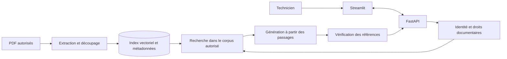

# MaintiDoc — Note de cadrage et architecture V1

Livrable L1.1 de l’étape « Socle documentaire et RAG textuel ». Référentiel pédagogique : *Feuille de route du projet IA générative multimodale et agentique*, étape 1, p. 2, et *Projet IA générative multimodale V2*, sections 2 à 4 et 10.

## Objectif et périmètre

Un technicien ou un responsable de maintenance pose une question en français sur une caractéristique, une procédure ou une périodicité. MaintiDoc recherche des passages dans les documents auxquels cette personne a accès, puis répond en indiquant les fichiers et pages qui justifient la réponse. Si les sources accessibles sont insuffisantes, l’assistant le signale.

Le corpus cible comprend 30 à 50 documents autorisés sur deux familles d’équipements. Le corpus actuel compte six PDF couvrant la pompe PC-200 et le moteur ME-30. Les tableaux peuvent contribuer aux réponses sous forme de texte structuré. L’analyse de photographies et de schémas, le fine-tuning, l’historique via MCP, les tickets et le bot relèvent des étapes suivantes.

## Architecture du prototype

- **Ingestion.** [ingestion.py](ingestion.py) lit et découpe le texte des PDF avec PyMuPDF et LlamaIndex. [extraction_multimodale.py](extraction_multimodale.py) extrait notamment les tableaux, puis [indexation_tableaux.py](indexation_tableaux.py) les convertit en texte structuré et les indexe.
- **Recherche.** Ollama exécute `nomic-embed-text`. PostgreSQL/PGVector stocke les passages et tableaux dans `data_chunks` et `data_tableaux`. Les métadonnées utilisées pour la provenance comprennent la famille, le fichier et la page.
- **Réponse.** [query.py](query.py) propose un parcours textuel et [query_multimodal.py](query_multimodal.py) combine texte et tableaux. Ollama exécute `llama3.2:3b` pour formuler la réponse. Le terminal affiche les sources récupérées.

## Architecture à livrer

À l’ingestion, conserver un identifiant et une version du document, la famille d’équipements, le fichier, la page et les groupes autorisés. Appliquer l’OCR local aux PDF scannés si le corpus en comporte.

À la requête, FastAPI associe la demande à une identité et transmet au RAG le périmètre autorisé. La recherche applique ce filtre avant de transmettre les extraits au modèle. L’API renvoie à Streamlit le statut de la réponse, son texte et les références vérifiables. Toute ouverture d’un document depuis l’interface passe aussi par un contrôle d’accès côté serveur.

## Écarts avec la feuille de route

| Composant | Feuille de route | Prototype | Décision ou travail restant |
| --- | --- | --- | --- |
| Base vectorielle | Qdrant | PostgreSQL/PGVector | PostgreSQL/PGVector validé pour la V1. |
| Embeddings | BGE-M3 | `nomic-embed-text` via Ollama | `nomic-embed-text` via Ollama validé pour la V1. |
| Chaîne RAG | LangChain | LlamaIndex | LlamaIndex validé pour la V1. |
| Corpus et extraction | 30 à 50 PDF autorisés, deux familles, PyMuPDF et OCR si nécessaire | Six PDF, deux familles, PyMuPDF et extraction des tableaux | Agrandir le corpus, vérifier les autorisations et appliquer l’OCR si nécessaire. |
| Métadonnées et accès | Versions, pages et droits d’accès | Famille, fichier et page | Ajouter les versions et les groupes, puis appliquer les droits à la recherche et à la consultation. |
| API et interface | FastAPI et Streamlit | Scripts en terminal | Exposer le RAG dans FastAPI et relier Streamlit à l’API. |
| Validation | Rapport de tests documentaires et d’accès | Évaluation préliminaire des réponses, documents retrouvés et latences | Vérifier le soutien des réponses par les pages citées et tester les accès autorisés et refusés. |

La V1 s’appuie sur la pile locale, dont les trois écarts techniques ont été confirmés le 26 novembre 2026.

## Critères de recette de la V1

| Scénario | Résultat attendu |
| --- | --- |
| Question technique avec source accessible | Depuis Streamlit, la réponse en français cite un fichier et une page qui soutiennent l’affirmation. Les valeurs et unités concordent avec le document. |
| Question sans réponse dans les sources accessibles | L’assistant signale le manque d’information. |
| Même question posée par deux profils aux droits différents | Les passages réservés sont disponibles pour le profil habilité et exclus de la recherche pour l’autre profil. |
| Ouverture directe d’un document réservé par un profil non habilité | L’API refuse l’accès au document. |

[Contexte technique](PROJECT_CONTEXT.md) · [Suivi du projet](PROGRESS.md) · [Évaluation historique](resultats_evaluation.json)
