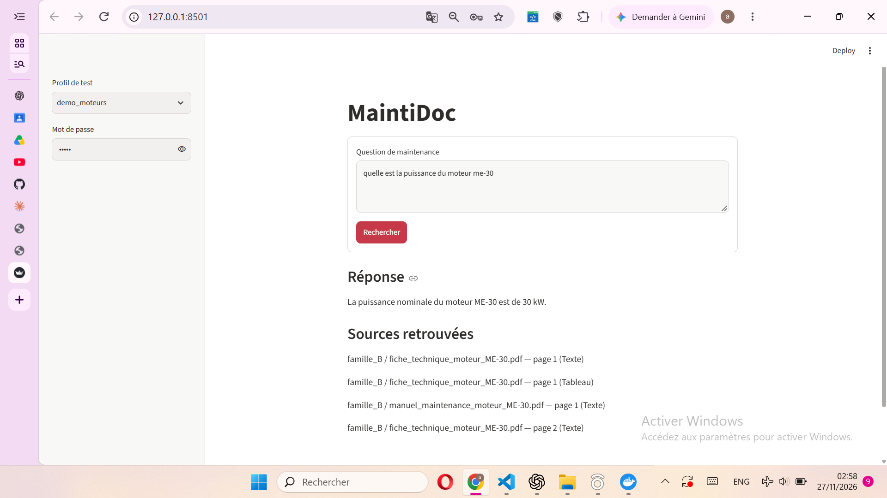
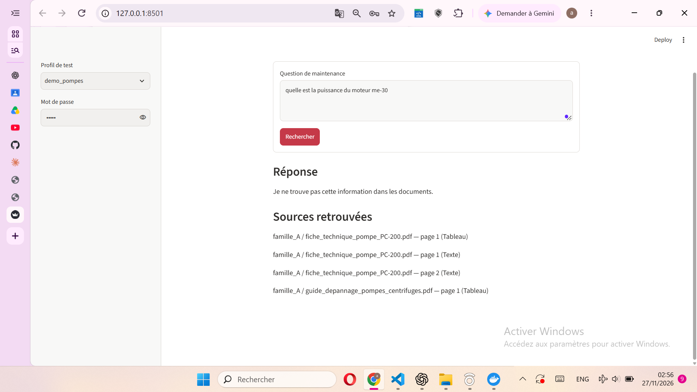

# MaintiDoc V1 — Rapport de tests documentaires et d’accès

**Livrable L1.6 · 27 novembre 2026**

La recette locale valide les scénarios ci-dessous sur le corpus pilote demandé par le professeur. Il comprend six PDF, trois sur les pompes et trois sur les moteurs. Les 14 points de l’index Qdrant représentent huit passages textuels et six tableaux. Les tests utilisent FastAPI, Streamlit et la chaîne LangChain avec BGE-M3 et `llama3.2:3b` via Ollama. [Inventaire](corpus/metadata.csv) · [Procédure de lancement](README.md#10-exécution-et-tests)

## Question documentaire et filtrage dans Streamlit

Question saisie avec les deux profils le 27 novembre 2026.

> quelle est la puissance du moteur me-30

| Profil | Résultat attendu | Résultat observé | Verdict |
| --- | --- | --- | --- |
| `demo_moteurs` | Répondre **30 kW** et retrouver la fiche du ME-30, page 1 | **30 kW**. La page 1 de `fiche_technique_moteur_ME-30.pdf` figure parmi les sources sous forme de texte et de tableau. Toutes les sources affichées relèvent de la famille moteurs. | Réussi |
| `demo_pompes` | S’abstenir et exclure les sources du groupe moteurs | « Je ne trouve pas cette information dans les documents. » Les quatre sources affichées proviennent de documents sur les pompes. | Réussi |

La page 1 de la fiche ME-30 contient la valeur et l’unité affichées. Dans le second scénario, les passages affichés correspondent aux résultats de recherche accessibles au profil pompes.

### Profil moteurs

### Profil pompes

## Accès direct à la fiche technique

Les tests automatisés via FastAPI ont appelé `GET /documents/moteur-me30-fiche`.

| Identité | Résultat attendu | Résultat observé | Verdict |
| --- | --- | --- | --- |
| `demo_moteurs` | HTTP 200 et contenu PDF | HTTP 200. Le corps commence par la signature PDF. | Réussi |
| `demo_pompes` | HTTP 403 | HTTP 403. | Réussi |
| Sans identifiants | HTTP 401 | HTTP 401. | Réussi |
| Mot de passe invalide | HTTP 401 | HTTP 401. | Réussi |

## Portée de la validation

Les six scénarios ci-dessus réussissent dans l’environnement local de démonstration. Le test Streamlit repose sur une question commune aux deux profils. Les vérifications d’accès portent sur les routes FastAPI et les comptes de démonstration du corpus pilote.

## Livrables de l’étape 1

| Référence | Élément du dépôt |
| --- | --- |
| L1.1 | [Note de cadrage et architecture](NOTE_CADRAGE_V1.md) |
| L1.2 | [Ingestion documentaire](index_qdrant.py) et [inventaire](corpus/metadata.csv) |
| L1.3 | [Configuration de Qdrant](docker-compose.yml), collection publiée sous l’alias `maintidoc_bge_m3` |
| L1.4 | [FastAPI](api.py) et [chaîne RAG](query_multimodal.py) |
| L1.5 | [Interface Streamlit](interface.py) et [instructions de lancement](README.md#10-exécution-et-tests) |
| L1.6 | Rapport et captures ci-dessus |
