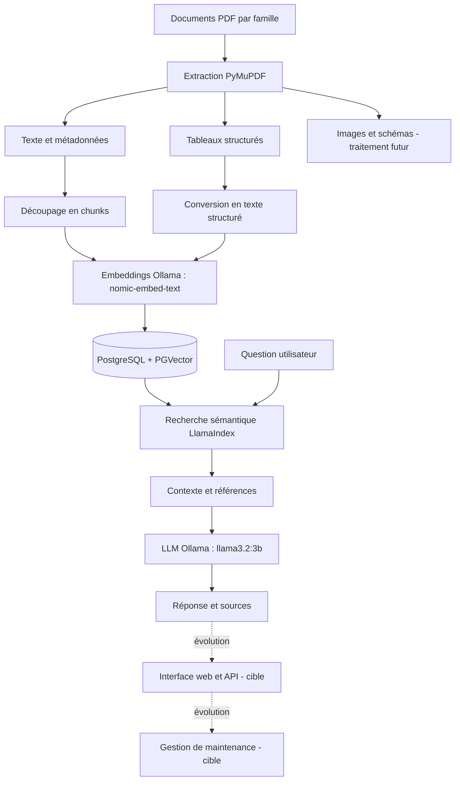

# MaintiDoc — Assistant intelligent de maintenance industrielle

> **Projet de bout en bout :** centralisation de la documentation technique, extraction multimodale, recherche sémantique, assistance au diagnostic et aide à la décision grâce à une architecture RAG locale.

**Statut :** prototype fonctionnel pour l'ingestion et la recherche documentaire ; développement des fonctionnalités applicatives avancées en cours / envisagé. Les sections « Vision cible » ne constituent pas des fonctionnalités déjà livrées.

## Sommaire

1. [Contexte et problématique](#1-contexte-et-problématique)
2. [Vision et objectifs](#2-vision-et-objectifs)
3. [Utilisateurs et cas d'usage](#3-utilisateurs-et-cas-dusage)
4. [Périmètre fonctionnel de bout en bout](#4-périmètre-fonctionnel-de-bout-en-bout)
5. [Architecture globale](#5-architecture-globale)
6. [Technologies](#6-technologies)
7. [Pipeline de données et d'IA](#7-pipeline-de-données-et-dia)
8. [Structure du dépôt](#8-structure-du-dépôt)
9. [Installation et configuration](#9-installation-et-configuration)
10. [Exécution et tests](#10-exécution-et-tests)
11. [Qualité, évaluation et sécurité](#11-qualité-évaluation-et-sécurité)
12. [Déploiement cible](#12-déploiement-cible)
13. [Feuille de route](#13-feuille-de-route)
14. [Limites et perspectives](#14-limites-et-perspectives)
15. [Contribution et licence](#15-contribution-et-licence)

## 1. Contexte et problématique

Dans un environnement industriel, les équipes de maintenance doivent consulter des **fiches techniques**, **manuels d'équipements**, **guides de dépannage** et **plans de maintenance**. Ces informations sont souvent dispersées entre plusieurs documents PDF, parfois organisés par familles de machines. Les tableaux de caractéristiques et les périodicités d'intervention sont particulièrement difficiles à retrouver rapidement par une simple recherche de mots-clés.

**Problématique centrale :** comment permettre à un technicien de maintenance de retrouver rapidement une information technique fiable, contextualisée et traçable, puis de l'exploiter pour le diagnostic et la préparation d'une intervention, sans parcourir manuellement l'ensemble de la documentation ?

MaintiDoc répond à ce besoin par un **assistant documentaire fondé sur le RAG** (*Retrieval-Augmented Generation*) : il recherche d'abord les passages pertinents dans les documents de l'entreprise, puis utilise un modèle de langage pour formuler une réponse en français et afficher les sources.

## 2. Vision et objectifs

### Vision produit

Construire une plateforme intelligente de maintenance industrielle, extensible à différentes familles d'équipements, qui relie **documentation**, **connaissances techniques**, **recherche sémantique**, **diagnostic assisté** et, à terme, **suivi des interventions**.

### Objectifs

- Centraliser et organiser les documents techniques par famille d'équipements.
- Extraire le texte et les tableaux des PDF ; préparer l'extension aux images et schémas.
- Transformer les contenus en embeddings pour une recherche par sens, et pas seulement par mots-clés.
- Générer des réponses ancrées dans les documents, avec indication des fichiers et pages sources.
- Faciliter la consultation des caractéristiques, procédures, symptômes et périodicités de maintenance.
- Évoluer vers une interface utilisateur, une API, des droits d'accès et un déploiement reproductible.

## 3. Utilisateurs et cas d'usage

| Profil | Besoin | Exemple de question |
|---|---|---|
| Technicien de maintenance | Consulter rapidement une consigne ou un paramètre | « Quelle est la puissance nominale du moteur ME-30 ? » |
| Responsable maintenance | Préparer et contrôler les opérations préventives | « À quelle fréquence faut-il regraisser les roulements ? » |
| Ingénieur méthodes | Comparer les données techniques et procédures | « Quelles sont les caractéristiques de la pompe PC-200 ? » |
| Nouvel arrivant | Comprendre la documentation existante | « Quelles sont les causes possibles des vibrations d'un moteur ? » |

**Exemples de documents de démonstration :** fiches et manuels des moteurs ME-30, de la pompe PC-200 et guides de dépannage des moteurs et pompes.

## 4. Périmètre fonctionnel de bout en bout

### 4.1 Fonctionnalités déjà réalisées ou vérifiées

- Lecture de PDF depuis `corpus/`, avec classement par familles.
- Extraction du texte et des tableaux avec PyMuPDF ; sauvegarde structurée dans `extractions/extractions.json`.
- Extraction d'images intégrées au PDF lorsque présentes (les PDF testés n'en ont pas fourni).
- Nettoyage et mise en forme textuelle des tableaux pour l'indexation.
- Génération d'embeddings locaux avec `nomic-embed-text` via Ollama.
- Stockage vectoriel dans PostgreSQL avec l'extension PGVector.
- Recherche sémantique et génération de réponses avec LlamaIndex et `llama3.2:3b`.
- Affichage des sources documentaires (famille, fichier, page et score de similarité).
- Tests de connexion à PostgreSQL, à Ollama et de recherche dans la table des tableaux.

**Résultat observé lors des tests :** 8 enregistrements dans `data_chunks` et 6 dans `data_tableaux`. Ce sont des chiffres du jeu de test, pas des objectifs de production.

### 4.2 Intégration en cours

- Recherche simultanée dans les passages textuels et les tableaux, avec un script dédié `query_multimodal.py` proposé pour les premiers essais.
- Vérification des réponses combinées, de leur traçabilité et de leur robustesse.

### 4.3 Vision cible (non encore implémentée)

- Interface web de consultation, recherche et questions/réponses.
- Import de documents par les utilisateurs, avec contrôle des formats et des versions.
- Gestion des équipements, familles, historiques et documents associés.
- Assistance au diagnostic sous forme de pistes documentées et vérifiables.
- Fiches d'intervention et suivi de maintenance préventive/corrective.
- Gestion des utilisateurs, rôles, permissions et journal d'audit.
- API applicative et déploiement conteneurisé de l'ensemble de la solution.
- Évaluation automatisée des réponses et supervision de l'application.

> Ces fonctionnalités décrivent la **direction globale du projet** ; leur conception exacte et leurs technologies restent à préciser avant implémentation.

## 5. Architecture globale



### Principaux composants

| Couche | Rôle |
|---|---|
| Corpus | Documents PDF regroupés par famille de machines |
| Extraction | Texte, tableaux, images et métadonnées |
| Préparation | Nettoyage, segmentation et représentation des tableaux |
| Embeddings | Représentation vectorielle des contenus et questions |
| Base vectorielle | Stockage et recherche de similarité dans PGVector |
| Orchestration RAG | Recherche, construction du contexte et appels au LLM |
| Génération | Réponses en français fondées sur le contexte retrouvé |
| Application cible | Interface, API, comptes, équipements et interventions |

## 6. Technologies

| Technologie | Usage dans MaintiDoc | État |
|---|---|---|
| Python 3.11 | Scripts d'extraction, ingestion et requêtes | Utilisé |
| PyMuPDF | Lecture PDF, extraction du texte, des tableaux et des images | Utilisé |
| LlamaIndex | Découpage, indexation, récupération et orchestration RAG | Utilisé |
| Ollama | Exécution locale des modèles | Utilisé |
| `nomic-embed-text` | Embeddings sémantiques (768 dimensions dans la configuration actuelle) | Utilisé |
| `llama3.2:3b` | Génération locale de réponses | Utilisé |
| PostgreSQL 16 + PGVector | Stockage des embeddings et recherche vectorielle | Utilisé |
| Docker / Docker Compose | Exécution du service de base de données | Utilisé |
| Git / GitHub | Versionnement et partage du code | Prévu pour le dépôt |
| Interface web / API | Expérience applicative et intégration | À définir |

Le projet utilise une approche **locale**, ce qui permet de tester la recherche et la génération sans dépendre d'une API de LLM externe. Cela ne dispense pas de sécuriser les fichiers et les accès à la base.

## 7. Pipeline de données et d'IA

### Étape A — Acquisition et organisation

Les documents sont placés dans `corpus/famille_A/`, `corpus/famille_B/`, etc. Chaque information extraite conserve au minimum la **famille**, le **nom du fichier** et la **page**.

### Étape B — Extraction documentaire

`extraction_multimodale.py` parcourt les PDF avec PyMuPDF et produit un JSON contenant notamment :

```json
{
  "famille": "famille_B",
  "fichier": "fiche_technique_moteur_ME-30.pdf",
  "page": 1,
  "texte": "...",
  "images": [],
  "tableaux": [["Paramètre", "Valeur"]]
}
```

La version enrichie de l'extraction prépare également des tableaux convertis en lignes de texte (champ `tableaux_texte` selon la version du script).

### Étape C — Préparation

Le texte est nettoyé et segmenté en passages (*chunks*). Les tableaux sont transformés en descriptions structurées de type « Paramètre : puissance nominale ; Valeur : 30 kW » pour préserver la relation entre colonnes et valeurs.

### Étape D — Embeddings

`nomic-embed-text` transforme chaque chunk ou tableau en vecteur de **768 dimensions**. La question utilisateur est transformée avec **le même modèle**, afin de comparer les vecteurs dans le même espace sémantique.

### Étape E — Indexation

Deux collections sont utilisées :

- `data_chunks` : passages textuels des PDF ;
- `data_tableaux` : tableaux convertis en texte structuré.

L'extension PGVector permet de rechercher les contenus dont les vecteurs sont proches de celui de la question.

### Étape F — Récupération et génération

La recherche sélectionne les passages pertinents ; le modèle `llama3.2:3b` reçoit la question et le contexte, puis formule une réponse. Le prompt lui demande de **ne pas inventer** d'informations absentes des documents. Ce garde-fou doit être vérifié par des tests : un prompt ne garantit pas à lui seul l'absence d'hallucinations.

### Étape G — Traçabilité

Les résultats affichent les noms des fichiers, pages et scores. À terme, l'application devra permettre d'ouvrir directement le passage ou la page citée.

## 8. Structure du dépôt

Structure représentative du projet observé et de son évolution :

```text
MaintiDoc/
├── corpus/
│   ├── famille_A/                  # PDF des pompes
│   └── famille_B/                  # PDF des moteurs
├── extractions/
│   ├── famille_A/                  # Images extraites, si présentes
│   ├── famille_B/
│   └── extractions.json           # Données documentaires extraites
├── ingestion.py                   # Indexation des textes
├── extraction_multimodale.py      # Extraction texte / tableaux / images
├── indexation_tableaux.py         # Indexation des tableaux
├── query.py                       # RAG textuel
├── query_multimodal.py            # RAG texte + tableaux (intégration à tester)
├── diagnostic.py                  # Script de diagnostic du prototype
├── test_extraction_texte.py       # Contrôle de l'extraction
├── test_tableaux_corriges.py      # Contrôle des tableaux
├── test_rag_tableaux.py           # Test de recherche vectorielle
├── docker-compose.yml            # Service PostgreSQL / PGVector
├── requirements.txt               # Dépendances Python
├── .gitignore                     # À créer / compléter
└── README.md
```

Les fichiers `.venv/` et `.venv311/` sont des environnements locaux et ne doivent pas être versionnés. Les scripts de test et le fichier `query_multimodal.py` peuvent varier selon l'état réel du dépôt.

## 9. Installation et configuration

### Prérequis

- Windows avec PowerShell (environnement utilisé pour le prototype) ;
- Python **3.11** ;
- Git ;
- Docker Desktop avec moteur démarré ;
- Ollama ;
- Ressources matérielles suffisantes pour exécuter le modèle local.

### Cloner et préparer le projet

```powershell
git clone <URL_DU_DEPOT>
cd MaintiDoc
python -m venv .venv311
.\.venv311\Scripts\Activate.ps1
python -m pip install --upgrade pip
python -m pip install -r requirements.txt
```

**Attention :** `<URL_DU_DEPOT>` est à remplacer par la véritable URL GitHub. Le fichier `requirements.txt` doit contenir toutes les dépendances réellement nécessaires. Les versions compatibles sont à figer avant une livraison reproductible.

### Démarrer PostgreSQL / PGVector

```powershell
docker compose up -d
docker compose ps
```

La configuration de démonstration utilise une base `maintidoc` sur `localhost:5432`, avec l'utilisateur `maintidoc`. Vérifier les valeurs dans `docker-compose.yml`.

### Préparer les modèles Ollama

```powershell
ollama pull nomic-embed-text
ollama pull llama3.2:3b
ollama list
```

Si Ollama est déjà lancé sur le poste, il n'est pas nécessaire de démarrer un deuxième serveur.

### Sécuriser la configuration

Les scripts du prototype contiennent actuellement des identifiants de base de données en dur. **Avant toute publication ou tout déploiement**, déplacer les paramètres et mots de passe vers des variables d'environnement ou un fichier `.env` ignoré par Git. Ne jamais publier des identifiants réels, des documents internes ou des données sensibles.

## 10. Exécution et tests

Depuis la racine du projet, avec `.venv311` activé :

### 10.1 Indexer les textes

```powershell
python ingestion.py
```

**Attention :** la configuration historique contient `RESET_TABLE = True` ; ce réglage supprime et reconstruit `data_chunks`. Vérifier sa valeur avant chaque exécution.

### 10.2 Extraire le contenu multimodal

```powershell
python extraction_multimodale.py
```

Le script enregistre les résultats dans `extractions/extractions.json`.

### 10.3 Indexer les tableaux

```powershell
python indexation_tableaux.py
```

### 10.4 Vérifier les collections

```powershell
docker exec maintidoc_db psql -U maintidoc -d maintidoc -c "SELECT 'textes' AS type, COUNT(*) FROM data_chunks UNION ALL SELECT 'tableaux', COUNT(*) FROM data_tableaux;"
```

### 10.5 Interroger les documents

```powershell
python query.py
```

### 10.6 Tester la recherche dans les tableaux

```powershell
python test_rag_tableaux.py
```

### 10.7 Tester la fusion texte + tableaux (après intégration)

```powershell
python query_multimodal.py
```

### Questions de validation

| Question | Information attendue dans le jeu de démonstration |
|---|---|
| Quelle est la puissance nominale du moteur ME-30 ? | 30 kW |
| Quelle est la périodicité du regraissage des roulements du ME-30 ? | 4 000 h |
| Quel est le débit maximal de la pompe PC-200 ? | 200 m³/h |
| Quelle est la vitesse de rotation de la pompe PC-200 ? | 1 450 tr/min |

Ces réponses servent de **cas de test** ; il faut vérifier le document cité et la page correspondante.

## 11. Qualité, évaluation et sécurité

### Évaluation RAG proposée

- **Qualité de récupération :** Recall@k, Precision@k ou MRR sur un jeu de questions annotées.
- **Exactitude des réponses :** comparaison avec des réponses de référence issues des manuels.
- **Fidélité aux sources :** vérifier que chaque valeur technique est effectivement présente dans le document cité.
- **Abstention :** tester les questions auxquelles le corpus ne répond pas.
- **Performance :** mesurer le temps d'extraction, d'indexation, de recherche et de génération.
- **Robustesse :** tester les PDF mal formés, les tableaux multi-pages, les unités et les fautes de frappe.

### Mesures de sécurité à prévoir

- Ne pas committer de secrets ni de documents industriels confidentiels.
- Mettre en place authentification et autorisation avant une ouverture multi-utilisateur.
- Valider les fichiers importés, limiter leur taille et tracer leur provenance.
- Restreindre l'accès à PostgreSQL et sauvegarder les données.
- Afficher un avertissement : l'assistant aide à consulter la documentation, mais ne remplace pas les procédures de sécurité ni la validation par un personnel habilité.

### Exemple de `.gitignore`

```gitignore
.venv/
.venv311/
__pycache__/
*.py[cod]
.env
.env.*
!.env.example
.vscode/
.pytest_cache/
*.log
# À adapter si les documents et extractions sont confidentiels :
# corpus/
# extractions/
```

## 12. Déploiement cible

**État actuel :** les scripts Python s'exécutent localement ; PostgreSQL/PGVector tourne dans Docker et Ollama est accessible depuis le poste.

**Architecture cible envisagée :** une interface web communique avec une API applicative ; l'API orchestre la recherche RAG, la gestion des documents et les fonctions de maintenance ; PostgreSQL conserve les métadonnées et les embeddings ; Ollama héberge les modèles. Une configuration Docker Compose plus complète pourra simplifier le lancement de l'ensemble.

Les choix précis de framework frontend, backend, hébergement et authentification **ne sont pas encore arrêtés**.

## 13. Feuille de route

| Phase | Livrables | Statut |
|---|---|---|
| 1. Environnement | Python, Git, Docker, PostgreSQL, Ollama | Réalisé |
| 2. Corpus et ingestion | Lecture PDF, chunks, embeddings, `data_chunks` | Réalisé et testé |
| 3. Extraction enrichie | Texte, tableaux, images intégrées et JSON | Réalisé ; validation sur corpus de test |
| 4. Indexation des tableaux | Texte structuré, embeddings, `data_tableaux` | Réalisé et testé |
| 5. Recherche sur tableaux | Similarité et affichage des sources | Testée |
| 6. Fusion RAG | Recherche texte + tableaux, réponse unifiée | En cours / à valider |
| 7. Interface et API | Application utilisable sans terminal | Vision cible |
| 8. Gestion maintenance | Équipements, interventions, historique | Vision cible |
| 9. Évaluation et sécurité | Jeux de tests, métriques, accès | À renforcer |
| 10. Déploiement | Packaging, documentation, supervision | Vision cible |

## 14. Limites et perspectives

- Les PDF de démonstration contiennent principalement du texte et des tableaux ; **aucune image intégrée n'a été détectée** lors des tests rapportés. L'interprétation visuelle de schémas n'est pas encore réalisée.
- Le nombre de documents et d'enregistrements est réduit ; il faut tester le comportement sur un corpus plus important.
- La recherche actuelle est sémantique ; un reranking, une recherche lexicale complémentaire et des filtres par équipement pourraient améliorer la pertinence.
- Les tableaux complexes, les PDF scannés et les images nécessiteront des traitements supplémentaires (par exemple OCR et/ou modèles de vision, après évaluation).
- Le système ne réalise pas encore de diagnostic autonome validé ni de maintenance prédictive sur des capteurs : ces fonctions demanderaient des données, des modèles et une validation spécifiques.
- Le fonctionnement multi-utilisateur et le déploiement complet restent à concevoir.

## 15. Contribution et licence

Projet développé dans un cadre d'apprentissage et de prototypage en intelligence artificielle et traitement de documents industriels.

**Auteur(s) :** à compléter.  
**Établissement / encadrement :** à compléter si applicable.  
**Dépôt GitHub :** à compléter.  
**Licence :** non définie ; ajouter un fichier `LICENSE` uniquement après choix explicite d'une licence.

---

**MaintiDoc : de la documentation industrielle dispersée à une assistance technique contextualisée, explicable et évolutive.**
